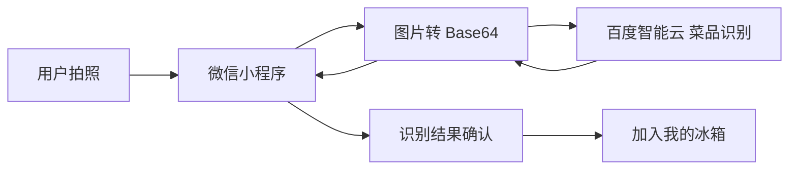

# FreshKeep

### AI 智能冰箱管家

> 让冰箱记得你买过什么。

    

技术栈：**微信小程序原生 + TypeScript + WXSS**，零第三方运行时依赖，MVP 数据全部走本地持久化（`wx.setStorageSync`），打开即可完整演示。

---

## 项目背景

家庭用户在购买食材后，经常面临：

- 不知道不同食材应该如何保存
- 买菜日期容易遗忘
- 冰箱库存缺乏管理
- 食材临期后才发现
- 面对已有食材不知道做什么

FreshKeep 希望把「现实冰箱」转化成「可被 AI 理解和管理的数字化冰箱」：拍照即识别、识别即建档、建档即提醒、临期即推荐，让每一次采购都被记住、被用好。

---

## Product Loop

```
买菜
  ↓
拍照 / 相册选图
  ↓
AI 菜品识别（百度智能云图像识别服务）
  ↓
确认食材（名称 / 数量 / 保存方式 / 分区 / 最佳食用期）
  ↓
智能保存建议
  ↓
加入冰箱
  ↓
记录保鲜周期
  ↓
临期提醒
  ↓
AI 食谱推荐
  ↓
消耗食材 → 更新库存
```

其中「AI 菜品识别」由 **百度智能云图像识别服务（菜品识别 `/rest/2.0/image-classify/v2/dish`）** 提供，识别结果经本地食材知识库补全保存建议后进入确认环节。

---

## AI Capability

### 01 图片识别
用户通过首页 / 冰箱页的拍照或相册入口上传食材图片。

### 02 菜品识别
调用 **百度智能云菜品识别 API**：先以 `client_credentials` 换取 `access_token`，再提交图片 base64 进行识别。

### 03 识别结果解析
将百度返回的结果转换为：

- 食材名称（`name`）
- 识别置信度（`probability`，0~1，低置信度时提示用户确认）
- 候选结果（百度返回 Top 列表，取 Top-1 进入确认流程）

### 04 食材管理
将用户确认后的结果写入冰箱库存（名称 / 数量 / 单位 / 购买日期 / 保存方式 / 分区 / 最佳食用期）。

### 05 后续智能能力
基于库存继续进行：保存建议、临期提醒、AI 食谱推荐。

> 识别层与业务层解耦：除百度菜品识别外，`services/ai` 还保留了可插拔的视觉 Provider 接口（Mock / OpenAI 兼容网关），便于后续替换或扩展其他模型。

---

## AI Architecture

当前为 **微信小程序直连百度智能云**（MVP 无后端）：



> ⚠️ 生产建议：上述链路中 Secret Key 会出现在客户端，存在被反编译泄露的风险。正式上线应在「微信小程序」与「百度智能云」之间增加一层**自有后端代理**：小程序把图片发到自己的服务端，由服务端持有密钥调用百度并返回结果（详见下方「凭证与安全管理」）。当前 MVP 为便于演示，凭证仅存于小程序本地存储，由管理员在「我的」页配置。

---

## 凭证与安全管理（重要）

本仓库**不含任何真实密钥**。两类凭证均不写死在前端代码：

| 能力 | 凭证 | 配置位置 | 存储方式 |
|------|------|----------|----------|
| 百度智能云菜品识别 | API Key / Secret Key | 「我的」页 → 管理员模式 → 百度智能云 | 小程序本地存储（仅本机） |
| OpenAI 兼容网关（食谱等） | API Key | 「我的」页 → 管理员模式 → AI 引擎 | 小程序本地存储（仅本机） |

**管理员模式开启方式**：在「我的」页**长按底部版本信息**（`鲜存 FreshKeep v1.0.0 · MVP Demo`）即可切换；开启后内部选项（AI 引擎 / 数据埋点 / 开发演示 / 百度智能云）才显示，状态本地持久化。

安全红线：

1. 真实密钥永不进入代码仓库（已在 `.gitignore` 排除 `*.local.ts` / `.env` 等）。
2. 微信小程序前端可被反编译，**Secret Key 不应下发到客户端**；正式环境务必改为后端代理。
3. 若此前密钥曾被硬编码在代码中，请第一时间到对应云控制台**轮换（重置）密钥**。

---

## 启动方式

1. 下载并安装 [微信开发者工具](https://developers.weixin.qq.com/miniprogram/dev/devtools/download.html)（稳定版）。
2. 打开开发者工具 → **导入项目** → 目录选择本项目根目录。
3. AppID 选择「测试号」或填入自己的小程序 AppID（真机预览 / 订阅消息需正式 AppID）。
4. 项目已开启 `useCompilerPlugins: ["typescript"]`，开发者工具自动编译 `.ts`，**无需 npm install**。
5. 点击「编译」，模拟器即可看到首页。

首次启动会自动写入演示食材，日期按「今天」动态计算，任何时间打开都能看到新鲜 / 即将到期 / 建议尽快食用三种状态。

> 调试真实接口：在开发者工具中勾选「不校验合法域名」（`project.config.json` 已设置 `urlCheck: false`）。

---

## 文件结构

```
Freshkeep/
├── app.ts / app.json / app.wxss     # 全局入口、TabBar、治愈风设计系统
├── pages/
│   ├── splash/                      # 开屏页
│   ├── home/                        # 首页：拍照入口、冰箱状态、临期提醒、今日推荐
│   ├── fridge/                      # 我的冰箱：搜索、分类、5 大分区可视化
│   ├── recipe/                      # 食谱：自然语言输入 + 筛选 + 推荐列表
│   ├── profile/                     # 我的：偏好、通知、埋点、开发演示、管理员密钥配置
│   ├── scan/                        # AI 拍照识菜：调用百度智能云菜品识别
│   ├── ingredient/                  # 确认食材：confirm / manual / edit 三合一
│   └── recipe-detail/               # 食谱详情 + 烹饪完成消耗闭环
├── assets/                         # 手绘线稿插画 / 图标 / TabBar
├── preview/design-preview.html      # 设计预览页（浏览器直接看）
├── types/                          # Ingredient / Recipe / User 等类型
├── data/                           # 食材知识库（28 种）/ 菜谱库（19 道）/ 演示数据
├── services/
│   ├── baidu/                      # 百度菜品识别凭证安全加载层（本地存储）
│   ├── ai/                         # 可插拔视觉 Provider 接口 + 网关 Provider + 配置
│   ├── food/                       # 保存建议 / 期限推算 / 冰箱 CRUD
│   ├── recipe/                     # 推荐引擎 + 意图解析
│   └── notification/               # 提醒引擎（本地模拟）+ 订阅消息接入位
├── utils/                          # date / storage / analytics / ui
├── components/                     # ingredient-card / recipe-card / expiration-card ...
└── tools/                         # gen_icons.py / gen_illustrations.py / smoke.mjs
```

---

## 已完成功能

| # | 功能 | 说明 |
|---|------|------|
| 0 | 开屏页 | 手绘线稿插画 + 品牌排版 + 底部进度线 |
| 1 | 首页 | 品牌 hero、拍照入口、冰箱状态、临期提醒、今日推荐 |
| 2 | AI 拍照入口 | 首页 / 冰箱页大卡，拍照 / 相册入口 |
| 3 | 图片上传 | `wx.chooseMedia`（自动降级 `wx.chooseImage`） |
| 4 | **AI 菜品识别（真实）** | 调用百度智能云菜品识别 API，返回名称 + 置信度 + 候选 |
| 5 | 食材确认页 | 名称 / 数量 / 单位 / 购买日期 / 保存方式 / 分区 / 最佳食用期 全可改 |
| 6 | 加入冰箱 | 识别结果写入库存，带成功反馈与跳转 |
| 7 | 冰箱食材列表 | 按紧急度排序，状态可视化（呼吸点 / 色块） |
| 8 | 冰箱分区 | 冷冻 / 冷藏 / 蔬果保鲜 / 门架 / 常温，可折叠 |
| 9 | 保存方式推荐 | 28 种食材知识库，给出方式 + 分区 + 参考时长 + 注意事项 |
| 10 | 最佳食用期计算 | 购买日期 + 参考天数自动推算 |
| 11 | 临期提醒 | 通知中心、首页提醒卡、今日建议文案、已读标记 |
| 12 | 食谱推荐 | 临期优先 > 匹配度 > 常做 > 耗时 > 缺料最少 |
| 13 | 食谱详情 | 匹配度、食材清单（已有 / 需购买）、步骤、开始烹饪 |
| 14 | 手动添加 | 复用确认页 `mode=manual`，也可从知识库选择 |
| 15 | 删除 / 消耗 | 编辑页移除；烹饪完成勾选扣减或自动移除 |
| 16 | 本地持久化 | 全部读写兜底 try/catch，存储失败不崩溃 |
| 17 | 空状态 | 冰箱空、搜索无结果、无匹配菜谱 |
| 18 | Loading | AI 识别进度 + 扫描动画 |
| 19 | 错误状态 | 无密钥 / 令牌失败 / 无结果 / 网络异常 / 图片过大 / 用户取消（均不崩溃） |
| 20 | 基础埋点 | 9+ 类事件 + 5 项核心指标，个人中心可查看 |
| 21 | 管理员模式 | 长按页脚进入，内部选项（AI 引擎 / 埋点 / 开发演示 / 百度密钥）仅管理员可见 |

**核心闭环**：拍照 → 百度菜品识别 → 保存建议 → 加入冰箱 → 临期提醒 → AI 推荐 → 开始烹饪 → 消耗扣减 → 冰箱更新。

---

## 接入微信订阅消息（预留）

MVP 阶段为前端本地提醒模拟，已预留 `requestSubscribe('TEMPLATE_ID_EXPIRATION')` 调用点；服务端下发可参考云函数定时任务，数据从本地存储迁到云数据库时只需替换 `services/food/fridge.ts` 的 `get/set` 实现。

---

## 埋点设计

| 事件 | 触发时机 |
|------|----------|
| `app_launch` | 小程序启动 |
| `photo_recognition_click` | 点击拍照 / 相册 / 识别入口 |
| `photo_recognition_success` | 识别成功（含名称、置信度） |
| `photo_recognition_failed` | 识别失败 / 网络异常 |
| `ingredient_added` | 食材入库 |
| `ingredient_consumed` | 烹饪完成消耗 |
| `expiration_reminder_clicked` | 点击「去做饭」 |
| `recipe_recommendation_view` | 推荐列表曝光 |
| `recipe_cook_clicked` | 点击「开始烹饪」 |
| `fridge_view` / `tab_switch` | 页面与 Tab 曝光 |

核心指标（个人中心可见）：**AI 识别成功率、食材添加数、食材消耗数、临期食材消耗率、食谱点击率**。

---

## 下一阶段可以做

1. **后端代理 + 真实视觉模型**：Secret Key 收归服务端，支持一张图识别多种食材。
2. **云开发 / 多端同步**：冰箱数据云同步，扫码录入（条码 → 商品名 → 保存建议）。
3. **家庭成员共享冰箱**：邀请码加入，多人协作添加 / 消耗。
4. **订阅消息 + 定时任务**：真实临期推送、每日菜谱推送。
5. **浪费账单 / 保鲜知识卡片 / 购物清单** 等体验增强。

---

## 免责声明

所有「保存时长」「最佳食用期」均为**参考值**，仅供食材管理使用，不构成食品安全标准。请结合食材实际状态（气味、颜色、触感）判断是否可食用。
